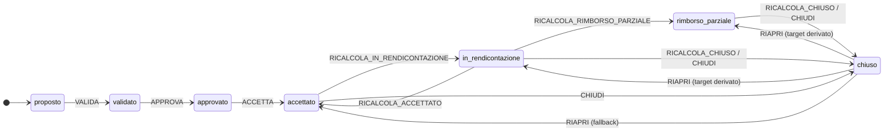
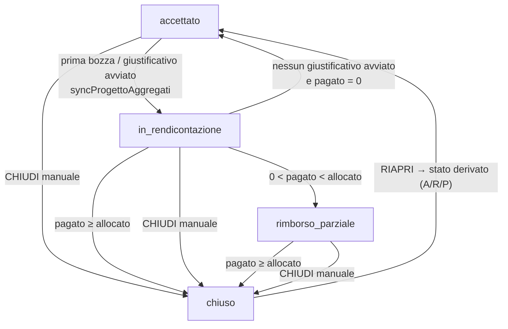
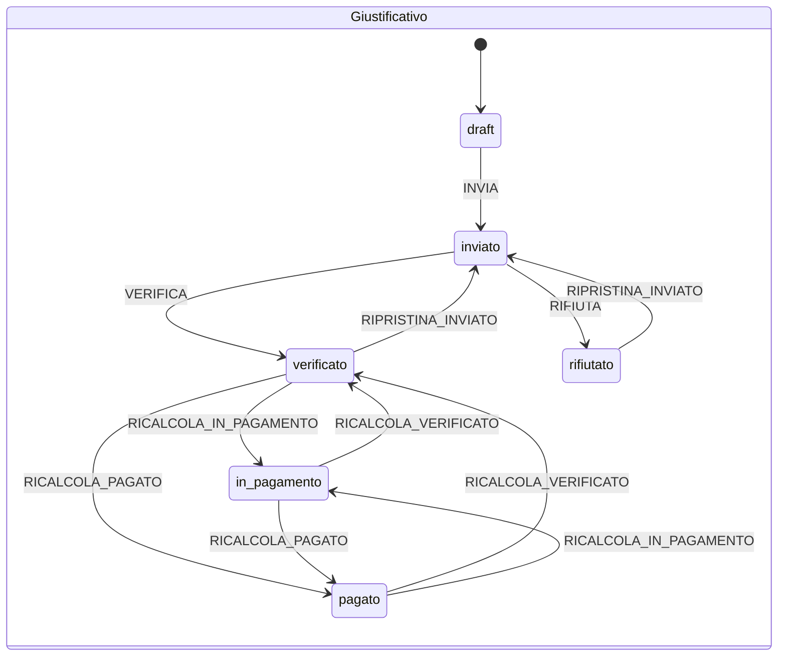
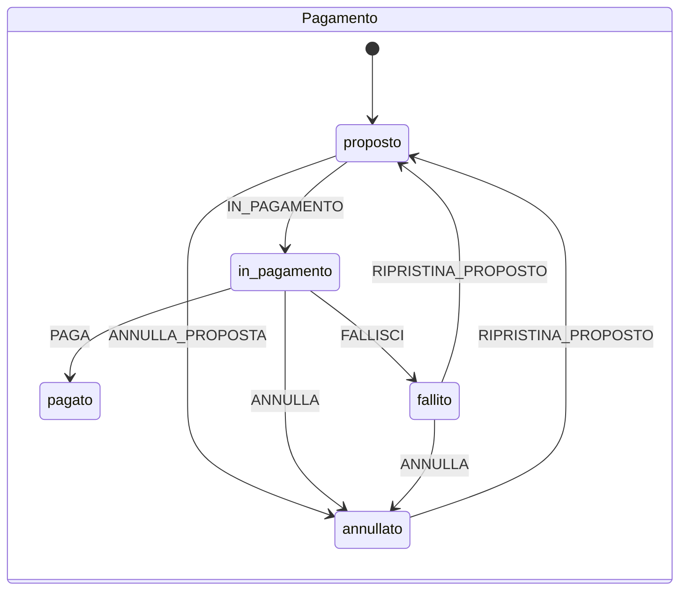

# Flussi di stato — ciclo di vita del progetto

Documento di riferimento sui flussi a partire da **progetto `accettato`**: quali
transizioni sono possibili, da cosa sono innescate, quali effetti collaterali
producono e dove si trovano gli entry point nell'interfaccia.

Fonti di verità (nessuna logica duplicata qui):

- Macchine a stati: `src/state-machines/{progetto,giustificativo,pagamento,submission}.js`
- Primitiva unica di scrittura: `src/usecases/stato/transita.js`
- Derivazione stato progetto: `src/utils/statoProgetto.js` (`calcolaStatoProgetto`)
- Use case: `src/usecases/{progetti,giustificativi,pagamenti}.js`

## Come visualizzarlo

- **GitHub**: i blocchi `mermaid` sono renderizzati nativamente (file view,
  PR, issue). Basta aprire questo file su `github.com/prinapo/volontari`.
- **VS Code**: con la versione **≥ 1.121** il preview Markdown renderizza Mermaid
  senza estensioni — apri il file e premi `Ctrl+Shift+V` (o `Ctrl+K V` per il
  side preview). Su versioni precedenti installa un'estensione Mermaid
  (`bierner.markdown-mermaid`, deprecata ma funzionante, oppure
  `vstirbu.vscode-mermaid-preview`).

---

## 1. Concetti e legenda

**Stati del progetto** (`STATO_PROGETTO`):

| Gruppo       | Stati                                                  | Operativo?                        |
| ------------ | ------------------------------------------------------ | --------------------------------- |
| Fase manuale | `proposto` → `validato` → `approvato`                  | no                                |
| Operativi    | `accettato`, `in_rendicontazione`, `rimborso_parziale` | **sì** (si creano giustificativi) |
| Finale       | `chiuso`                                               | no                                |

- `accettato` è **anche lo stato di nascita**: `creaProgetto` crea direttamente
  in `accettato` (`creaConStato`). È l'equivalente operativo del legacy `aperto`
  (normalizzato da `statoProgettoEffettivo`).
- `rimborso_parziale` è **operativo**: la famiglia può ancora inserire
  giustificativi fino al rimborso totale.
- `chiuso` è l'**unico stato finale** ed è **sticky**: `calcolaStatoProgetto` non
  lo retrocede mai a `rimborso_parziale`.
- La chiusura registra un **motivo** in `Progetti.TipoChiusura`: `cap_raggiunto`
  (automatico al cap), oppure `rinuncia`/`irraggiungibile`/`fine_anno`/`errore`/
  `altro` (manuale). La **chiusura annulla l'eventuale proposta pendente** (non
  più dovuta).
- Il `TipoChiusura` non è uno stato macchina: è un attributo della chiusura,
  azzerato alla riapertura.
- `Giustificativi.Invalidato` è un flag **ortogonale** allo `Stato`: non è uno
  stato macchina e non compare nei diagrammi di stato.

**Regole di ingaggio del codice**:

- Ogni cambio di stato passa **solo** da `transita()` (o `creaConStato` /
  `creaConStatoIniziale`). Nessuno store/componente scrive `StatoProgetto` o
  `Stato` direttamente (vietato da ESLint `no-restricted-syntax`).
- I valori **derivati** (`StatoProgetto`, `StatoRendicontazione`, totali) sono
  calcolati da selettori puri a partire da dati freschi.

---

## 2. Macchina Progetto (transizioni dichiarate)

Da `accettato` l'unico innesco automatico è `in_rendicontazione`; non si passa
direttamente a `rimborso_parziale` e non si chiude in automatico (solo `CHIUDI`
manuale). Da `rimborso_parziale` il progetto va **solo in avanti** (→ `chiuso`),
mai indietro.

Legenda eventi:

| Evento                           | Significato                                                                                                     |
| -------------------------------- | --------------------------------------------------------------------------------------------------------------- |
| `VALIDA` / `APPROVA` / `ACCETTA` | avanzamento fase manuale (un solo step, solo in avanti)                                                         |
| `RICALCOLA_*`                    | transizione **automatica/derivata** (idempotente)                                                               |
| `CHIUDI`                         | chiusura **manuale** ("Chiudi progetto")                                                                        |
| `RIAPRI`                         | riapertura da `chiuso`; target **derivato** (guardie `allocato>0`, `residuo>0`, conferma per motivi definitivi) |

> Nota: `[*] --> proposto` è l'`initial` della macchina. I progetti **nuovi**
> non passano da `proposto`: `creaProgetto` li crea in `accettato`. La fase
> manuale serve per progetti che arrivano in quegli stati (import) e avanza con
> `avanzaStatoProgetto`.

---

## 3. Regole di derivazione (`calcolaStatoProgetto`)

Lo stato atteso è calcolato in quest'ordine (la prima regola che scatta vince):

| #   | Condizione                                                                            | Risultato             |
| --- | ------------------------------------------------------------------------------------- | --------------------- |
| 1   | `StatoProgetto` nullo o legacy `aperto`                                               | base `accettato`      |
| 2   | stato attuale ∈ {`proposto`,`validato`,`approvato`}                                   | **resta invariata**   |
| 3   | `allocato > 0` **e** `rimborsato ≥ allocato`                                          | `chiuso` (auto)       |
| 4   | stato attuale = `chiuso`                                                              | `chiuso` (**sticky**) |
| 5   | `0 < rimborsato < allocato`                                                           | `rimborso_parziale`   |
| 6   | esiste ≥1 giustificativo **avviato** (non invalidato: `draft`, `inviato` o contabile) | `in_rendicontazione`  |
| 7   | altrimenti                                                                            | `accettato`           |

- `rimborsato` = somma dei pagamenti in stato `pagato` (`TotalePagato`).
- "giustificativo avviato" = `Stato ∈ {draft, inviato, verificato, in_pagamento, pagato}`
  e `Invalidato ≠ true`. **Anche una bozza avvia la rendicontazione**: appena la
  famiglia salva un `draft` il progetto passa a `in_rendicontazione`
  (`StatoRendicontazione = 'bozza'`); se l'ultima bozza viene eliminata/invalidata
  torna `accettato`. Le bozze non contano negli importi di Verifica.
- Le regole 3/5 sono transizioni **automatiche** legittime solo da
  `in_rendicontazione`/`rimborso_parziale`: la derivazione le calcola anche da
  `accettato`, ma la macchina **rifiuta** `accettato → rimborso_parziale`/`chiuso`
  (`TransizioneNonValidaError`), segnalando lo stato anomalo.

---

## 4. Flusso integrato da `accettato`

> La riapertura (`RIAPRI`) **non** atterra sempre su `accettato`: il target è
> calcolato da giustificativi e pagamenti freschi (`accettato`,
> `in_rendicontazione` o `rimborso_parziale`), con le guardie `allocato > 0` e
> `residuo > 0` e conferma esplicita per i motivi definitivi.

### 4.1 Chi causa le transizioni (macchine "driver")

Il progetto non cambia mai stato "da solo": sono le mutazioni dei suoi
giustificativi e dei suoi pagamenti a innescare i ricalcoli.

> Nota sul ciclo del bonifico: una tranche (batch) pagata è chiusa e non si
> riapre. Un pagamento `fallito` (IBAN/intestatario errati, conto bloccato…) non
> torna `in_pagamento` nello stesso gruppo: dopo la correzione dei dati
> (`correggiDati`) si riporta a `proposto` con `RIPRISTINA_PROPOSTO` (`Batch`
> azzerato) e confluisce in una **nuova** tranche.

**Ponte driver → progetto**:

- un giustificativo diventa **avviato** (bozza, `inviato` o contabile) →
  `syncProgettoAggregati` → progetto `in_rendicontazione` (o ritorno ad
  `accettato` quando l'ultimo avviato sparisce);
- un pagamento diventa `pagato` → `ricalcolaTotaliProgetto` → progetto
  `rimborso_parziale` (parziale) o `chiuso` (cap raggiunto). Gli stati
  `in_pagamento`/`fallito`/`annullato` **non** fanno transire il progetto: solo
  `TotalePagato` (pagamenti `pagato`) incide sullo stato.

---

## 5. Tutti i casi possibili da `accettato`

| Da                   | Evento                         | Condizione                                                               | A                                                                                | Causa (azione)                                                    | Entry point UI                                                  | Side-effect                                                                        |
| -------------------- | ------------------------------ | ------------------------------------------------------------------------ | -------------------------------------------------------------------------------- | ----------------------------------------------------------------- | --------------------------------------------------------------- | ---------------------------------------------------------------------------------- |
| `accettato`          | `RICALCOLA_IN_RENDICONTAZIONE` | ≥1 giustificativo avviato (bozza inclusa), `pagato = 0`                  | `in_rendicontazione`                                                             | crea bozza / invia / verifica / aggiorna giustificativo           | volontario → `giustificativi.store`; manager → `verifica.store` | `syncProgettoAggregati`                                                            |
| `accettato`          | `CHIUDI`                       | —                                                                        | `chiuso` (manuale)                                                               | "Chiudi progetto"                                                 | `RendicontazioneTab` → `pagamenti.store.chiudiProgetto`         | set `DataChiusura`, `MotivoChiusura`, `TipoChiusura`; annulla la proposta pendente |
| `in_rendicontazione` | `RICALCOLA_ACCETTATO`          | nessun giustificativo avviato e `pagato = 0`                             | `accettato`                                                                      | elimina/invalida l'ultima bozza o rifiuta l'ultimo giustificativo | volontario → `giustificativi.store`                             | `syncProgettoAggregati`                                                            |
| `in_rendicontazione` | `RICALCOLA_RIMBORSO_PARZIALE`  | `0 < pagato < allocato`                                                  | `rimborso_parziale`                                                              | pagamento parziale                                                | `PagamentiTab`                                                  | `ricalcolaTotaliProgetto` + `sincronizzaStatiPagamentoProgetto`                    |
| `in_rendicontazione` | `RICALCOLA_CHIUSO`             | `pagato ≥ allocato`                                                      | `chiuso` (auto)                                                                  | segna pagato che raggiunge il cap                                 | `PagamentiTab`                                                  | `ricalcolaTotaliProgetto` → `chiudiProgetto({automatica:true})`                    |
| `in_rendicontazione` | `CHIUDI`                       | —                                                                        | `chiuso` (manuale)                                                               | "Chiudi progetto"                                                 | `RendicontazioneTab`                                            | set `DataChiusura`, `MotivoChiusura`, `TipoChiusura`; annulla la proposta pendente |
| `rimborso_parziale`  | `RICALCOLA_CHIUSO`             | `pagato ≥ allocato`                                                      | `chiuso` (auto)                                                                  | segna pagato che raggiunge il cap                                 | `PagamentiTab`                                                  | `ricalcolaTotaliProgetto` → `chiudiProgetto({automatica:true})`                    |
| `rimborso_parziale`  | `CHIUDI`                       | —                                                                        | `chiuso` (manuale)                                                               | "Chiudi progetto"                                                 | `RendicontazioneTab`                                            | set `DataChiusura`, `MotivoChiusura`, `TipoChiusura`; annulla la proposta pendente |
| `chiuso`             | `RIAPRI`                       | `allocato > 0` e `residuo > 0` (conferma esplicita se motivo definitivo) | target **derivato** (`accettato` \| `in_rendicontazione` \| `rimborso_parziale`) | "Riapri progetto"                                                 | `RendicontazioneTab` → `pagamenti.store.riapriProgetto`         | azzera `DataChiusura`, `MotivoChiusura`, `TipoChiusura`                            |

---

## 6. Transizioni NON possibili

| Tentativo                                                             | Esito                                                                |
| --------------------------------------------------------------------- | -------------------------------------------------------------------- |
| `accettato` → `proposto`/`validato`/`approvato`                       | **impossibile**: la fase manuale non retrocede                       |
| `accettato` → `rimborso_parziale`                                     | **impossibile**: da `accettato` si passa solo a `in_rendicontazione` |
| `accettato` → `chiuso` automatica                                     | **impossibile**: chiusura solo manuale (`CHIUDI`)                    |
| `rimborso_parziale` → `accettato`/`in_rendicontazione`                | **impossibile**: il progetto va solo in avanti (→ `chiuso`)          |
| `chiuso` → `rimborso_parziale`/`in_rendicontazione` via `RICALCOLA_*` | **impossibile**: da `chiuso` esiste solo `RIAPRI`                    |
| `avanzaStatoProgetto` da `accettato` o oltre                          | lancia `TransizioneNonValidaError` ("progetto non in fase manuale")  |
| Creare un progetto in stato ≠ `accettato`                             | `creaConStato` valida lo stato dichiarato (solo `accettato`)         |
| Modificare `StatoProgetto` fuori da `transita`                        | bloccato da ESLint `no-restricted-syntax`                            |

> Nota: `chiuso → in_rendicontazione`/`rimborso_parziale` **non** è più
> impossibile in assoluto: la riapertura (`RIAPRI`) ha un target **derivato** da
> giustificativi e pagamenti (con le guardie `residuo > 0` e `allocato > 0`, e
> conferma esplicita per i motivi **definitivi**: rinuncia, irraggiungibile,
> fine anno).

---

## 7. Catene di side-effect (invarianti)

| Funzione                                | Innescata da                                                                                          | Cosa fa                                                                                                                                                     |
| --------------------------------------- | ----------------------------------------------------------------------------------------------------- | ----------------------------------------------------------------------------------------------------------------------------------------------------------- |
| `syncProgettoAggregati(progettoId)`     | **ogni** mutazione di giustificativo (crea, invia, aggiorna, verifica, rifiuta, invalida, riconcilia) | Ricalcola `TotaleGiustificativi`, `TotaleImporto`, `StatoRendicontazione`, `StatoProgetto` da dati freschi (progetto + giustificativi + pagamenti) e PATCHa |
| `ricalcolaTotaliProgetto(progettoId)`   | ogni cambio di pagamento, `ricalcolaProposta`, bulk RICALCOLA                                         | Ricalcola `TotaleVerificato/Proposto/InPagamento/Pagato/ResiduoAllocato`; **chiude** il progetto se il cap è raggiunto                                      |
| `sincronizzaStatiPagamentoProgetto(id)` | `segnaInPagamento`/`segnaPagato`/`segnaFallito`/`segnaAnnullato`/`ripristina*`                        | Riallinea gli stati dei giustificativi contabili al pagamento collegato (e al cap allocato); azzera le FK `Pagamento` orfane                                |
| `ricalcolaProposta(progettoId)`         | verifica/rifiuta/aggiorna campo (manager), `segnaAnnullato`                                           | Crea/aggiorna/annulla il pagamento `proposto` (aggiorna anche `IBAN`/`Intestatario`); collega/scollega i giustificativi; poi ricalcola totali               |
| `ricalcolaPropostiDaProgetti(rows)`     | pulsante "RICALCOLA"                                                                                  | Versione bulk di `ricalcolaProposta` sui progetti operativi (dati freschi dal DB; riporta i fallimenti)                                                     |
| `chiudiProgetto(id, {automatica})`      | cap raggiunto (auto) o "Chiudi progetto" (manuale)                                                    | `transita` con `RICALCOLA_CHIUSO` o `CHIUDI`; set `DataChiusura`/`MotivoChiusura`/`TipoChiusura`; annulla la proposta pendente                              |
| `riapriProgetto(id)`                    | "Riapri progetto"                                                                                     | `transita` con `RIAPRI`; azzera `DataChiusura`/`MotivoChiusura`/`TipoChiusura`                                                                              |
| `inviaNotificaPagamento(pagamento)`     | dopo `segnaPagato`                                                                                    | Invia l'email al volontario/genitore e marca `NotificaInviata`                                                                                              |

**Ordine tipico di `segnaPagato`** (`usecases/pagamenti.js`):

1. `transita(PAGA)` sul pagamento → `pagato`
2. `ricalcolaTotaliProgetto` (può chiudere il progetto automaticamente)
3. `sincronizzaStatiPagamentoProgetto` (giustificativi → `pagato`)
4. `inviaNotificaPagamento`

**Ordine tipico della verifica giustificativo** (`stores/verifica.store.js`):

1. `verificaGiustificativo` → `transita(VERIFICA)` + `syncProgettoAggregati`
2. `pagamenti.store.ricalcolaProposta(progettoId)` → aggiorna il `proposto`

---

## 8. Mappa eventi → entry point

| Evento / azione                 | Use case                                    | Store                                                            | UI                                                                       |
| ------------------------------- | ------------------------------------------- | ---------------------------------------------------------------- | ------------------------------------------------------------------------ |
| Crea progetto (`accettato`)     | `creaProgetto`                              | pagina (use case diretto)                                        | `CreaProgettoPage`                                                       |
| Avanza fase manuale             | `avanzaStatoProgetto`                       | `pagamenti.store`                                                | `RendicontazioneTab` ("Avanza stato progetto")                           |
| Chiudi progetto (manuale)       | `chiudiProgetto`                            | `pagamenti.store`                                                | `RendicontazioneTab` ("Chiudi progetto", con motivo)                     |
| Riapri progetto                 | `riapriProgetto`                            | `pagamenti.store`                                                | `RendicontazioneTab` ("Riapri progetto", conferma per motivi definitivi) |
| Crea gruppo di pagamento        | `segnaInPagamento`                          | `pagamenti.store.creaBatch` (ricalcola le proposte)              | `PagamentiTab` ("Crea gruppo di pagamento")                              |
| Segna pagato                    | `segnaPagato`                               | `pagamenti.store`                                                | `PagamentiTab` ("Segna pagato")                                          |
| Segna fallito                   | `segnaFallito`                              | `pagamenti.store`                                                | `PagamentiTab` ("Segna fallito")                                         |
| Rimuovi dal gruppo / annulla    | `segnaAnnullato`                            | `pagamenti.store`                                                | `PagamentiTab` ("Rimuovi dal gruppo")                                    |
| Ripristina a "Bonifici da fare" | `ripristinaProposto`                        | `pagamenti.store`                                                | `PagamentiTab` ("Ripristina a Bonifici", tab Falliti)                    |
| Correggi dati pagamento         | `correggiDati`                              | `pagamenti.store`                                                | `PagamentiTab` (tab Falliti; solo `fallito`)                             |
| Ricalcola proposte (bulk)       | `ricalcolaPropostiDaProgetti`               | `pagamenti.store`                                                | `PagamentiTab` ("RICALCOLA")                                             |
| Verifica giustificativo         | `verificaGiustificativo`                    | `verifica.store`                                                 | `RendicontazioneTab` / `Verifica` (azione "Verifica")                    |
| Rifiuta giustificativo          | `rifiutaGiustificativo`                     | `verifica.store`                                                 | `RendicontazioneTab` / `Verifica` (azione "Rifiuta")                     |
| Invia bozza giustificativo      | `inviaGiustificativo`                       | `giustificativi.store` (volontario) / `verifica.store` (manager) | card giustificativo / `RendicontazioneTab`                               |
| Ripristina a `inviato`          | `aggiornaCampoGiustificativo`               | `verifica.store`                                                 | `RendicontazioneTab` (azione "Ripristina")                               |
| Invalida giustificativo         | `invalidaGiustificativo`                    | `giustificativi.store`                                           | card giustificativo (solo bozze)                                         |
| Crea giustificativo             | `creaGiustificativo`                        | `giustificativi.store` / `verifica.store`                        | form giustificativo (volontario/verificatore)                            |
| Crea submission (modulo libero) | `creaSubmission`                            | `submit.store`                                                   | `SubmitPage`                                                             |
| Riconcilia submission           | `riconciliaSubmission`                      | `verifica.store`                                                 | `RiconciliazionePage`                                                    |
| Scarta / ripristina submission  | `scartaSubmission` / `ripristinaSubmission` | `verifica.store`                                                 | `RiconciliazionePage`                                                    |

---

## 9. Verifiche e note

- **`RICALCOLA_ACCETTATO`** è emesso **solo da `in_rendicontazione`**, quando
  non resta nessun giustificativo avviato (ultima bozza eliminata/invalidata o
  ultimo giustificativo rifiutato) e `pagato = 0`
  (`eventoRicalcoloProgetto('accettato')`). Da `rimborso_parziale` non è più
  previsto: il progetto va solo in avanti.
- **Contratto da `accettato`**: l'unico innesco automatico è
  `in_rendicontazione`; `rimborso_parziale` e `chiuso` automatici sono vietati
  (chiusura solo manuale). Da `rimborso_parziale` sono vietati i ritorni a
  `accettato`/`in_rendicontazione`.
- **Bozze**: una `draft` avvia la rendicontazione (progetto
  `in_rendicontazione`, `StatoRendicontazione = 'bozza'`); lo stato di riga
  mostra "Bozze da inviare" finché non viene inviata.
- **`chiuso` sticky**: `syncProgettoAggregati` su un progetto `chiuso` calcola
  sempre `chiuso` come target, quindi la condizione `statoRaw === statoProgetto`
  è vera e viene fatta solo la PATCH dei derivati (nessuna transizione).
- **Legacy `aperto`**: `statoProgettoEffettivo` lo normalizza a `accettato`
  **prima** di interrogare la macchina; un eventuale residuo legacy non deve
  essere scritto di nuovo (la scrittura del branch legacy è stata rimossa).
- **Modulo libero**: la submission **non** crea giustificativi; la
  materializzazione avviene solo alla riconciliazione, che crea un
  giustificativo `inviato` (quindi il progetto passa a `in_rendicontazione`).
- **Chiusura**: `TipoChiusura` (`cap_raggiunto` automatico; motivo scelto a
  mano); la chiusura **annulla la proposta pendente**. **Riapertura**: target
  derivato, guardie `allocato > 0`/`residuo > 0`, conferma esplicita per i motivi
  definitivi (`rinuncia`/`irraggiungibile`/`fine_anno`).
- **`fallito` → `proposto`**: un bonifico fallito non torna `in_pagamento` nella
  stessa tranche; dopo `correggiDati` si ripristina a `proposto` (`Batch`
  azzerato) e confluisce in una **nuova** tranche.
- **Dati freschi**: `syncProgettoAggregati` legge i **pagamenti** (non il
  `TotalePagato` persistito) tramite `calcolaDerivatiProgetto`; `creaBatch`
  ricalcola le proposte dei progetti coinvolti prima di creare la tranche.
- **`inviaGiustificativo`** applica la guardia "progetto operativo": una bozza
  salvata prima della chiusura non è inviabile.
- **`Rendicontazioni.Stato`** non è un'entità a macchina: resta un valore
  scritto direttamente (eccezione ESLint documentata).
